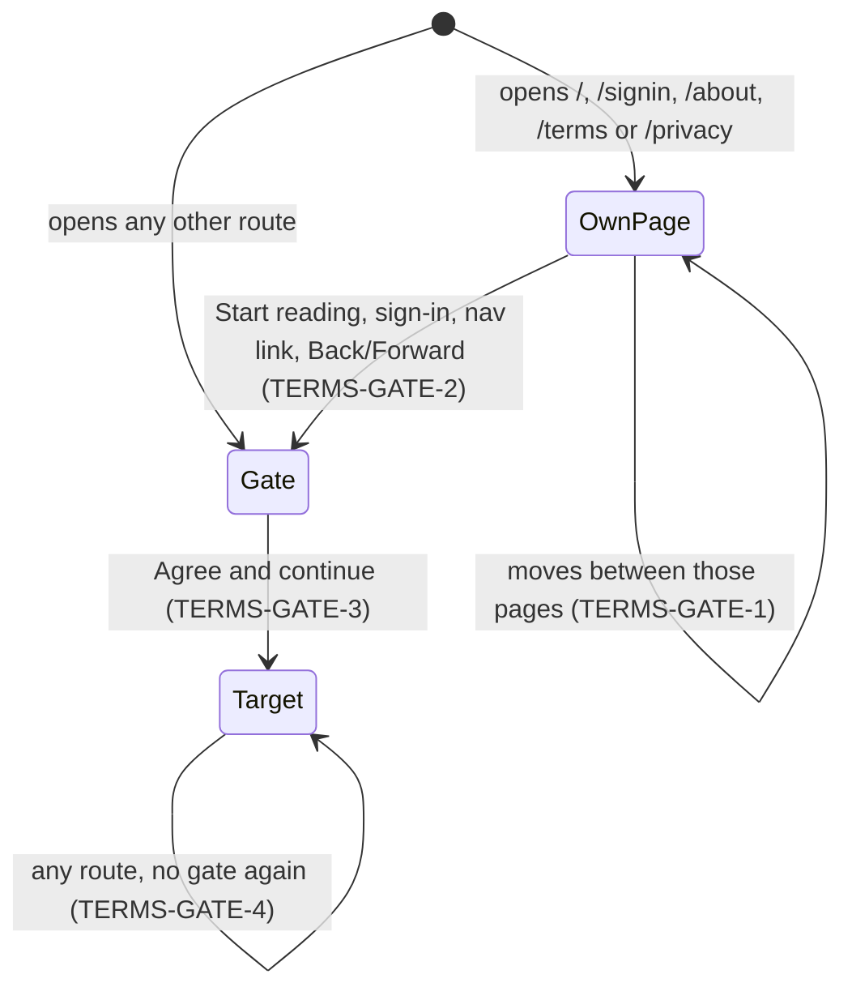

# Terms gate

## Purpose

Nobody sees anything from the Nostr network before they have been told what
nox is and agreed to the terms. The gate guards the network's content, not the
app's own pages, so a first-time visitor can see what nox is before deciding
to agree.

## Behaviour

Pages that show only nox's own words are open before agreeing: the landing
page (`/`, `/signin`), About (`/about`), Terms (`/terms`) and Privacy
(`/privacy`). Nothing on them comes from a relay.

Every other route shows the "Before you start" screen first: the global
timeline, a hashtag, a profile, a post, search, home after signing in. That
covers every way of getting there: "Start reading", finishing a sign-in, a link
on About, the navigation bar, a shared link opened directly, and Back or
Forward. After "Agree and continue" the visitor lands on the route they were
going to, not on the landing page.

Until the terms are accepted, no relay connection is opened and no background
fetch of posts starts.

## Acceptance

- TERMS-GATE-1: A visitor who has not accepted the terms can open `/`,
  `/signin`, `/about`, `/terms` and `/privacy`, and move between them,
  without the terms screen.
- TERMS-GATE-2: From those pages, any route other than them shows the terms
  screen before anything on that route loads, whether reached by a button, a
  link, the navigation bar, search, or Back/Forward. Opening such a route
  directly shows the terms screen first, as before.
- TERMS-GATE-3: Agreeing continues to the route the visitor was going to.
- TERMS-GATE-4: Once accepted, the terms screen does not appear again until
  `TERMS_VERSION` changes, as before.
- TERMS-GATE-5: Before acceptance, no relay WebSocket is opened and no
  background post fetch or service-worker sync of posts starts.

## Not doing

- The phone app. It has no landing page; its first screen stays the terms
  screen.
- A "decline" path. Leaving the gate without agreeing is closing the tab or
  going Back to one of the open pages.

## Open

- Should signing in (connecting an extension, a signer or a key) be possible
  before agreeing, with the gate shown on the way to Home? This spec says yes:
  connecting a key reads nothing from relays.
